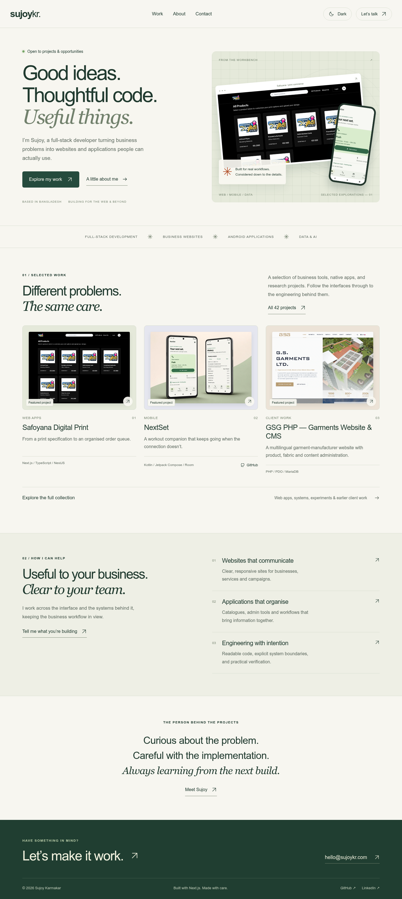

# Sujoy Karmakar · portfolio

A Next.js / React / TypeScript portfolio for client conversations and engineering applications. Includes 40 case studies, larger readable typography, light/dark themes, searchable category filters and 207 additional gallery images.



## Run locally

Node.js 20.9+ and npm are required. No database, API keys or environment variables are needed.

```sh
npm ci
npm run dev
# http://localhost:3000
```

```sh
npm test
npm run typecheck
npm run build
# Static deployment output: out/
```

**Cloudflare Pages:** framework preset "Next.js (Static HTML Export)", build command `npm run build`, output directory `out`, Node 22 (pinned by `.node-version`). Set `NEXT_PUBLIC_SITE_URL` if the production origin differs from the default `https://sujoykr.pages.dev`.

The application uses Next.js App Router and static export. The theme follows the operating system on a first visit; the header switch saves an explicit light/dark preference in browser storage. It continues to work when storage is unavailable. Contact links open an email client; there is no implied form backend. Nothing was deployed.

## Change project images

Every project has its own folder. The folder name matches its `slug` in `src/data/projects.json`:

```text
public/
  images/
    safoyana/
      thumbnail.webp    ← project card, homepage and case-study cover
      image1.webp       ← first gallery image
      image2.webp
      image3.webp
      gallery.json      ← optional captions and original-source information
    nextset/
      thumbnail.webp
      image1.webp
      image2.webp
      ...
    clipping/
      thumbnail.webp
      image1.webp
      ...
    profile/
      portrait.webp
```

1. **Replace a thumbnail:** overwrite `thumbnail.webp`, or remove it and add `thumbnail.png` / `thumbnail.jpg`. Keep exactly one `thumbnail` file per project.
2. **Add a gallery image:** place `image4.png`, `image5.jpg`, etc. in that project’s folder, using an unused number. PNG, JPG/JPEG, WebP, AVIF, GIF and SVG are supported. Images sort numerically, so `image10` follows `image9`.
3. **Refresh the index:** run `npm run images`. This is also run automatically before `npm run dev`, `npm run build`, and `npm test`. If the dev server is already running, run `npm run images` in a second terminal; Next.js picks up the updated gallery data.
4. **Optionally add accessible image descriptions:** edit `gallery.json`. These descriptions are used for accessible image labels; the gallery itself displays only images. Unlisted numbered files still appear automatically, with a default description. When replacing an image with another file type, use its new filename in the metadata if you want a custom caption.

Example optional metadata:

```json
{
  "thumbnail": { "source": "My updated project cover" },
  "images": {
    "image1.webp": {
      "caption": "Customer order configuration",
      "source": "My local application capture",
      "kind": "local"
    },
    "image2.png": {
      "caption": "Staff order queue",
      "source": "My local application capture",
      "kind": "local"
    }
  }
}
```

Do not manually edit `src/data/galleries.json` or `public/asset-sources.json`: `scripts/sync-images.mjs` generates them from the folders and optional metadata. Removing an image file removes it from the gallery on the next refresh, even if an old caption remains in `gallery.json`. Avoid duplicate image numbers with different extensions; the indexer reports a clear error instead of showing ambiguous ordering.

A thumbnail is displayed only as the cover above the gallery. Matching numbered copies are automatically excluded when their original-source metadata or file contents match the thumbnail. The files are kept so you can change the cover later. When choosing a different cover, also update `thumbnail.source` in `gallery.json` to identify its new original image; this lets the old cover return to the gallery. Projects with only a cover do not show an empty gallery.

The images are local copies, so editing them does not alter the original project repositories. Existing WebP copies are optimised for the website; long archived pages retain their full composition. Galleries use a responsive masonry layout: two columns for mixed interface images, three for portrait collections, and one on small screens. Regular images keep their proportions, phone screens are bounded in height, and very long pages use a compact top-of-page preview. The viewer always opens the complete original image. There are no visible captions or screen labels. Click an image to open the viewer, then use the zoom buttons (up to 800%), double-click to toggle zoom, and drag or scroll to inspect details. Previous/next buttons and the left/right arrow keys change images; Escape closes the viewer.

## Change project text

Edit `src/data/projects.json` for titles, short pitches, audiences, overviews, engineering details, highlights, technologies and presentation order. `order`, `group` and `featured` control the collection presentation. Image filenames belong in their project folders, not in this content file. Basic HTML/CSS/JavaScript/Bootstrap labels are omitted from the public technology displays. Projects using only that stack show their design approach and client-facing purpose instead; the original stack remains in the content data for reference.

Every project has a case-study page. Public source buttons remain omitted for GSG as requested. The ten earlier frontend/client entries link to the old portfolio repository containing their material.

## Image context

The galleries include all available screenshot sets from the selected applications, existing Android/repository galleries, and the earlier portfolio, plus relevant project diagrams, historical research plots and substantial design visuals. Small interface icons, launcher variants, favicons and raw catalogue/product-stock libraries are not presented as project screenshots.

Screenshots, archival captures, earlier research reports, design assets and original artwork retain their context in project descriptions and accessible image labels. Projects with no interface captures retain labelled illustration thumbnails. Images do not establish current external-service availability or new application runtime results. `public/asset-sources.json` records provenance.

## Verification

`npm test` checks repository coverage, complete content, source-button rules, local image paths/provenance, expanded galleries and automatic discovery/numeric ordering of newly added files. `scripts/browser_check.py` checks all 40 exported case studies and their complete galleries, theme persistence, search/filter/sort, keyboard gallery navigation, and mobile layouts in both themes.

```sh
python3 -m http.server 3400 --bind 127.0.0.1 --directory out
# In another terminal, using a Python environment with Playwright installed:
python3 scripts/browser_check.py
```

Chrome defaults to `/usr/bin/google-chrome`; override with `CHROME_PATH`. Set `PORTFOLIO_URL` to test another local address. Review screenshots are in `docs/screenshots/`; the dark version is shown in `home-dark-desktop.png`.


The public case studies focus on implemented functionality, design choices and practical value. Temporary portfolio-capture setup notes and audit panels are kept out of the site. Notepad AI’s Ollama testing was confirmed by the project developer, and its cover uses the original repository screenshot showing a local model and assistant response.

The current collection has 40 projects and 14 Client work entries, including Kyra, eAppair, Regro Media and GSG. The LAB article layout is represented within LAB, and the previous portfolio is no longer a separate case study. Regro’s latest user-provided full-page capture is stored at `public/images/regro-media/image2.webp` at its original 1920 × 7488 resolution. The older 1440 × 6334 capture remains archived under `../regro-media/docs/screenshots/`. Talentrack’s gallery uses the current screenshot files; metadata for the deleted diagrams and hero asset has been removed.

## Combined projects and source links

LAB (`lab`) combines the public website and admin panel. Medikart (`medikart`) combines its storefront and API. DermaCare (`dermacare`) combines the cosmetics storefront and commerce API. Each case study includes both GitHub repositories, defined by its `repositories` array; `sourceRepos` preserves the original repository IDs. The `github` field remains the primary source link used on collection cards. Existing unreferenced image folders are retained so earlier assets are preserved.

The live GSG website is linked from its case study. Its nine latest user-provided captures are kept at full dimensions in the gallery, including the homepage and three admin views. A separate top-section homepage crop provides the thumbnail. NextSet uses a generated cover composition, with its real Android screens retained separately. See [cover generation details and final prompt](docs/NEXTSET-COVER.md).

eAppair uses the latest user-provided full-page homepage capture at its original 1920 × 4330 dimensions in the gallery, with a separate top-section crop as its thumbnail.

Safoyana’s 18 application captures use six locally served, realistic AI-generated print-product photos rather than the logo. The dashboard is captured after CSS and chart animations finish. Customer cart/account/category views and more admin product/category/customer/detail pages are included. Canteen Manager includes 13 captures of the actual React/Express/MariaDB demo at a 1440 × 1000 desktop viewport, including all eight reports. Hood Up includes the 14 remaining user-provided Android captures at their original dimensions. Its generated two-phone cover follows NextSet’s studio presentation with Hood Up’s orange accents; see [cover details and final prompt](docs/HOOD-UP-COVER.md).

Nine projects with genuine interface captures use reference-led artistic covers, with flat asymmetric mosaics or bold diagonal page strips, a uniform 30% black overlay, and lossless 3200 × 1800 exports. Scripts, API-only projects and other entries without interface captures use their earlier covers. Mobile projects, other Client work entries and the six existing archived collage covers are preserved. Regro Media and eAppair use the newly requested artistic covers while retaining their complete gallery captures. See [cover design, prompts and regeneration](docs/COVER-DESIGN.md).

The homepage hero uses dedicated high-resolution crops of the GSG homepage and Hood Up workshop screen, stored under `public/images/hero/`. Project collection thumbnails use their original dimensions and natural aspect ratios, filling their rounded links without padding, colored framing, badges or shadows, and retain a small hover zoom. Thumbnail links open the case study; gallery images keep the existing enlarged viewer.

Thumbnails without existing darkening receive a 30% black-equivalent display overlay on collection cards and case-study covers. Existing baked overlays are recognized through `thumbnail.overlay` or `thumbnail.overlayBaked: true` in `gallery.json`, preventing double darkening. Gallery screenshots and hero images are unaffected.
